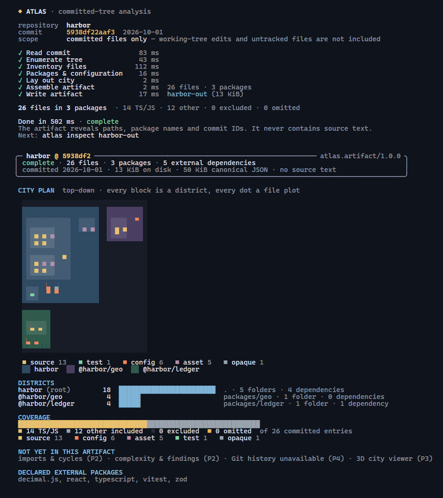
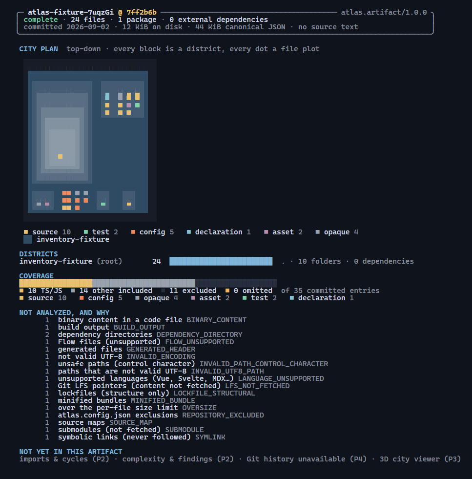
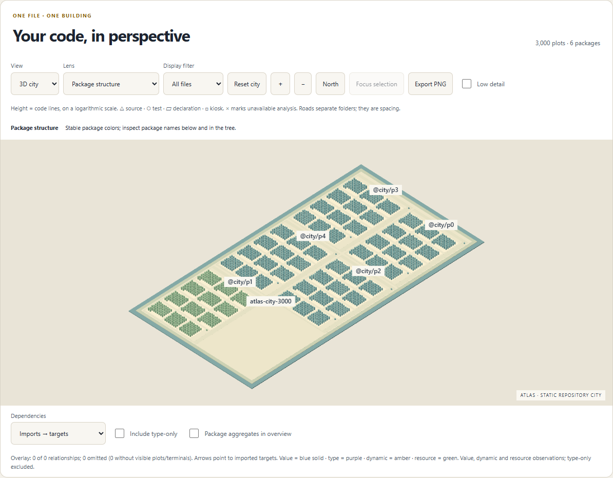
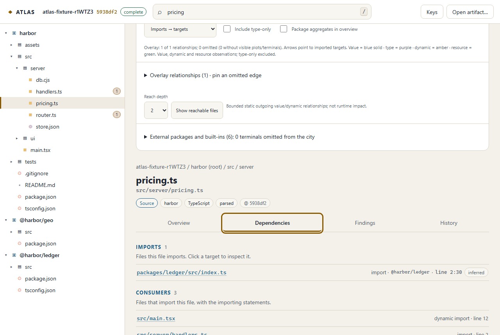
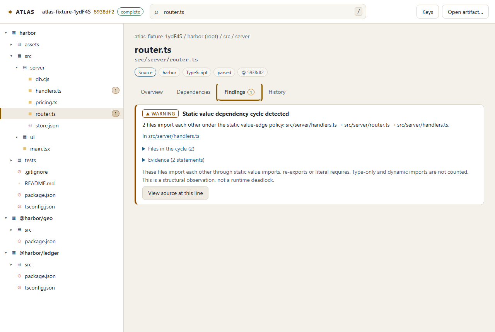

# ATLAS: your codebase as a city

[](https://github.com/urveesh09/project-atlas/actions/workflows/ci.yml)
[](https://github.com/urveesh09/project-atlas/actions/workflows/security.yml)
[](https://scorecard.dev/viewer/?uri=github.com/urveesh09/project-atlas)
[](LICENSE)

ATLAS turns the committed contents of a TypeScript/JavaScript repository into a navigable, explainable miniature city:

- packages become districts, folders become blocks and files become buildings;
- static imports are an overlay you can inspect;
- diagnostics and hotspots carry their evidence;
- a bounded Git history lets you scrub and compare snapshots without the city reshuffling.

Every visual encoding has a legend, every finding has evidence, and every gap in the analysis is shown as coverage.

> **Status:** All four pillars and the hosted public-GitHub implementation are available. Phase 6 adds pinned real-repository validation, repeated capacity measurements and a portable CLI candidate tested outside the development checkout. See the [candidate install/demo guide](docs/release/README.md), [release audit](docs/release/release-audit.md) and [implementation status](docs/implementation-status.md). G6 remains open for the exact capacity-fixture matrix, human usability/accessibility, reference-device and public-infrastructure acceptance. Runtime tracing stays deferred.

**New here? Read [Start here](docs/START_HERE.md)** for setup, every way to run ATLAS, and the remaining release steps.
Releases, the demo site and security practice are described in the [release process](docs/release/release-process.md);
to report a vulnerability see [SECURITY.md](SECURITY.md), and to contribute see [CONTRIBUTING.md](CONTRIBUTING.md).

## Try it

**[Open the live demo](https://urveesh09.github.io/project-atlas/)**: ATLAS in your browser on
an analysis of [vuejs/core](https://github.com/vuejs/core) (702 files, 12 history snapshots).
Nothing to install; the analysis contains paths, metrics and relationships, never source
text.

For a portable archive that needs only Node and Git after extraction, follow the
[candidate guide](docs/release/README.md). To build from this checkout:

```sh
pnpm install --frozen-lockfile
pnpm build && pnpm build:web
pnpm atlas doctor
pnpm atlas analyze path/to/repo --out ./atlas-output
pnpm atlas inspect ./atlas-output
pnpm atlas verify ./atlas-output
pnpm atlas serve ./atlas-output --repo path/to/repo
```



Every pixel of the city plan comes from the artifact's layout chunk: package districts, folder blocks and one plot per file, colored by role. Anything not analyzed is listed with a reason:



Explore the same fixed plots in 3D, map or accessible table views. Structure, complexity and fan-in lenses have numeric legends; unknown metrics stay unknown. Selection synchronizes with search, tree and evidence without moving the camera. Camera focus is explicit.



Incoming/outgoing overlays retain direction and kind. Visible arcs are capped at 200, with omitted counts and a complete paged list; pinning an omitted relationship makes it visible. Package rollups and up to 50 external terminals offer another scale of navigation. PNG export includes separate JSON provenance. Keyboard controls, touch gestures, reduced motion and automatic map fallback preserve access to the same data.

The browser explorer keeps file relationships and their evidence visible. Type-only imports are separate from default dependency counts:



Findings explain their static policy and limitations, including an actual cycle witness:



Only committed files are analyzed. History is enabled by default: up to 90 days, 200 first-parent commits and 12 sampled frames. Use `--history-days`, `--history-commits` and `--snapshots` to lower that scope, or `--no-history` for one selected frame with churn/hotspots explicitly unavailable. `serve` without `--repo` still supports graph inspection; source access requires an explicit repository attachment. Opening an exported artifact through the browser's file picker never uploads it.

Artifacts use a lossless indexed graph transport ([ADR-018](docs/adr/ADR-018-indexed-graph-transport.md)); decoded identities remain full SHA-256 IDs. Writers emit artifact 1.3 with lossless frame-delta graphs and compact history/layout ([ADR-026](docs/adr/ADR-026-frame-delta-and-compact-transports.md)). The 128 MiB cumulative cap counts stored JSON bytes; each reconstructed chunk is separately bounded and historical graphs are loaded on demand. Readers also accept 1.0, 1.1 and 1.2. The compressed limit stays 20 MiB. [ADR-024](docs/adr/ADR-024-decoded-artifact-capacity.md) explains the capacity decision and memory tradeoff. Layout 1.1 bounds external anchors without changing file plots or graph identity.

## V0.1 capabilities

| Pillar | Capability |
|---|---|
| Structure & navigation | Packages and directories as nested districts; search, tree, breadcrumbs, inspector, source links |
| Dependencies | Directed static file imports/re-exports with evidence ranges and confidence; external package perimeter; static cycles |
| Diagnostics & hotspots | Parse errors, unresolved imports, cycles, complexity, size, fan-in and change-concentration findings, each explainable from raw metrics |
| Git evolution | Bounded first-parent history, renames and lineage, sampled snapshots, A/B compare on fixed plots |

It runs two ways: a local CLI (`atlas analyze`, then `atlas serve`) that never uploads anything, and a hosted service for public GitHub repositories. Runtime tracing is explicitly out of scope ([ADR-012](docs/adr/ADR-012-runtime-pillar-deferred-in-full.md)).

## Hosted service

The hosted service analyzes public GitHub repositories and publishes each result for 7 days, at an immutable link. Submission works like this:

1. Paste a repository root URL.
2. Accept the public-output notice.
3. Follow the stages; you can cancel at any point.
4. Open the city.

Each analysis takes these steps:

- Acquisition runs Git in a container whose only route out is an egress broker. The broker allows only GitHub, pins validated public addresses and counts every byte.
- Analysis runs the CLI's analyzer in a container with no network.
- A verified HEAD checkpoint is kept, so failures while analyzing history still publish the latest commit as PARTIAL.

The viewer reads published chunks only after the service has checked the repository's visibility, the result's expiry and that it has not been deleted. The submitting browser session can delete a result. Local analysis never uploads anything.

```sh
ATLAS_DATABASE_URL=postgres://... node scripts/hosted-dev.mjs          # development processes, Harbor fixture
ATLAS_DATABASE_URL=postgres://... node scripts/hosted-dev.mjs --docker <sandbox image id> [--github]
```

See [hosted development](docs/hosted-development.md) and [operations](docs/hosted-operations.md).

## Safety model in one paragraph

Repository contents are data, never instructions. ATLAS reads committed Git objects through an ATLAS-generated Git directory with a scrubbed environment. It never checks out, installs, builds or runs hooks, filters, helpers or repository configuration, and analysis has no network access. These properties are tested: the trap suite arms every Git execution hook and proves none fire ([ADR-016](docs/adr/ADR-016-safe-git-acquisition-spike-results.md)).

The hosted service repeats these properties inside containers. A sentinel suite covers committed scripts, plugins, filters and submodules, and the pipeline is also tested for network isolation and missing-blob lazy fetch ([ADR-031](docs/adr/ADR-031-hosted-acquisition-and-analysis-pipeline.md)).

## Developing

Prerequisites: Node.js 24.15.0, pnpm 10.34.6 and Git ≥ 2.38 ([toolchain](docs/toolchain.md)).

```sh
pnpm install
pnpm --filter @atlas/web exec playwright install --with-deps chromium
pnpm verify              # typecheck + viewer build + dependency direction + contracts + tests
pnpm test:watch
pnpm --filter @atlas/web dev   # viewer shell and the instancing spike at /spike.html
```

| Command | Purpose |
|---|---|
| `pnpm build` | Compile all library packages (`tsc -b`) |
| `pnpm typecheck` | Build, then type-check tests and the viewer |
| `pnpm check:deps` | Enforce the package dependency direction and runtime-deferral ban |
| `pnpm contracts:generate` / `contracts:check` | Regenerate or verify JSON Schema and OpenAPI from the runtime schemas |
| `pnpm spike:render` | Measure the WebGL instancing spike in Chromium |
| `node scripts/bench-analysis.mjs` | 20 measured medium HEAD runs with cold parser caches; checks time and artifact size |
| `node apps/web/scripts/bench-city.mjs --firefox` | 20-run production viewer/layout gate, dense fixtures, cold route, heap/disposal, Firefox and screenshots; install Firefox first |
| `ATLAS_NETWORK_TESTS=1 pnpm exec vitest run packages/ingest/test/github.test.ts` | Live GitHub acquisition spike |

## Repository layout

```text
apps/web/                 shared viewer (React, Vite, imperative Three.js production city; R3F spike)
apps/api/                 hosted HTTP API: admission, status/SSE, publications, viewer serving
apps/worker/              coordinator, sandbox entrypoints (broker, acquisition, analysis), sweepers, atlas-ops
packages/control/         hosted control plane: migrations, roles, private storage, GitHub budget, publication lifecycle
deploy/                   sandbox and API images, development compose stack
packages/schema/          canonical contracts, IDs, canonical JSON, validators, generated JSON Schema
packages/ingest/          sanitized local Git reader, GitHub admission and filtered acquisition
packages/analyzer-ts/     TS/JS syntax facts and virtual-filesystem module resolution
packages/analyzer-core/   committed inventory, package hierarchy, artifact assembly
packages/graph/           aggregation, SCC witnesses, search and bounded reach queries
packages/history/         first-parent history, lineage and change activity
packages/layout/          deterministic integer city layout
packages/artifact/        deterministic chunks, bounded import (Node + browser), atomic output
packages/cli/             the atlas command: doctor, analyze, inspect, verify, serve
packages/test-fixtures/   handcrafted artifact, Git fixture builder, Harbor demo repository
docs/                     master plan, ADRs, contracts, benchmarks, status
```

The dependency direction is enforced in CI: schema is foundational, analyzers never depend on the viewer or API, and the viewer never imports analyzer or ingestion code.

## Documentation

- [Start here](docs/START_HERE.md) for people; [AGENTS.md](AGENTS.md) for coding agents
- [V0.1 master plan](docs/plan/PROJECT_ATLAS_V0.1_MASTER_PLAN.md): the specification
- [Implementation status](docs/implementation-status.md): tasks, evidence and the next step
- [Architecture decision records](docs/adr/)
- Hosted service: [development](docs/hosted-development.md), [operations and runbooks](docs/hosted-operations.md), [operator rehearsal](docs/benchmarks/phase5-rehearsal.md)
- Contracts: [identity](docs/contracts/identity.md), [metrics](docs/contracts/metrics.md), [capabilities](docs/contracts/capabilities.md), [CLI](docs/contracts/cli.md), [OpenAPI](docs/api/openapi.json), [JSON Schemas](packages/schema/generated/)
- [Phase 0 rendering benchmark](docs/benchmarks/phase0-render-spike.md)
- [Phase 2 analysis benchmark](docs/benchmarks/phase2-analysis.md), [transport decision](docs/adr/ADR-018-indexed-graph-transport.md), [Phase 2 decisions and gate](docs/adr/ADR-019-phase2-static-analysis-and-viewer.md)
- [Phase 3 city benchmark](docs/benchmarks/phase3-city.md), [production viewer decision](docs/adr/ADR-020-production-city-viewer.md), [validated worker ownership](docs/adr/ADR-023-retain-validated-query-worker.md)

## License

[MIT](LICENSE)
