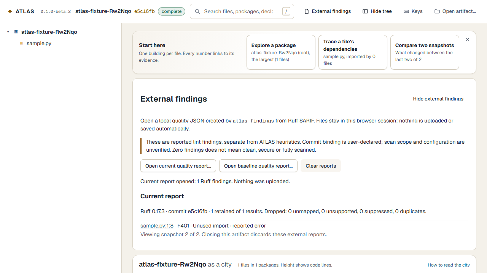

# External Ruff findings

This optional local workflow imports reported lint findings. It runs no scanner,
repository code, plugins, tests or fixes, and uploads nothing. It does not provide
SonarQube parity, vulnerability scanning or a merge-quality verdict (ADR-085).

## Produce a report separately

Use your existing trusted Ruff installation/CI against the **same committed contents**
as an analyzed ATLAS snapshot, from the repository root. Working-tree edits can
invalidate that relationship. ATLAS cannot authenticate Ruff's scanned revision.
For example, in a checkout you control:

```sh
ruff check --isolated --select F401,F821 --output-format sarif --no-cache . > ruff.sarif
```

Ruff exits nonzero on lint errors; that alone does not mean report generation failed.
ATLAS does not execute this command. Version 1 supports one-run **Ruff SARIF 2.1.0**,
physically checked with Ruff 0.17.3. Other producers and URI-base indirection are
unsupported. Never install or run an untrusted repository to generate an analysis.

## Bind to an analyzed snapshot

Obtain a full commit ID from `atlas inspect ./atlas-output --json`. Then:

```sh
atlas findings ./ruff.sarif --artifact ./atlas-output --commit FULL_COMMIT_ID --source-root . --out ./quality.json
```

`--commit` must name an analyzed frame. `--source-root` maps absolute local `file:` URIs
to committed paths; it reads no source. Relative URIs are relative to the repository
root. No basename guessing or remote fetch occurs. Machine paths are not retained.

Choose a new output filename **outside** the artifact directory. Existing files are
never overwritten. Core artifacts, hashes, identities and analysis versions stay
unchanged. Sidecars are not in public publications or the server's file inventory.
File mode is 0600 where supported.

Exit 0 means successful import, **not a clean scan**. Exit 2 means records were dropped
(duplicate-only reduction remains 0); 1 is failure, 64 usage and 130 cancellation.
`--json` reports counts/categories. Unsupported positions, unmapped files and suppressed
records are counted. Limits: 8 MiB UTF-8, 20,000 input records, 4,096 retained findings,
bounded positive positions. Exceeding capacity fails rather than sampling findings.

## Inspect and compare

Open the artifact with `atlas serve` or the browser picker. Choose **External findings
→ Open current quality report…**, and pick `quality.json`. The disposable import worker
checks structure; references are checked against the artifact again. A row selects its
file in the city/tree and opens Findings. No raw message, snippet, fix, arbitrary
property, link or host path is retained/rendered. Rule labels are controlled by ATLAS.
F401 and F821 have friendly labels; other supported rule codes use a generic lint
label. Consult the original trusted scanner output for its full explanation.



Reports stay in memory for the artifact session, with at most current and baseline.
Closing the panel preserves them; clearing reports or replacing the artifact discards
them. Failed imports preserve previous reports. A historical report is hidden on
other frames; **Show report snapshot** returns to it. HTML/map/table access needs no GPU.

Import another report using its own full analyzed commit ID and the **same artifact**.
Open it with **Open baseline quality report…**, or use:

```sh
atlas findings ./ruff-new.sarif --artifact ./atlas-output --commit FULL_NEW_COMMIT_ID --out ./quality-new.json --baseline ./quality-old.json
```

Comparison needs the same analysis and Ruff version. It matches rule, lineage, line and
column. Labels are **newly reported**, **no longer reported** and **at the same location**.
Line movement can create unmatched locations on both sides; severity can change at a
matched location. Commit binding is user-declared; scope/configuration are unverified.
Zero or disappearing results never establish clean coverage, safety or resolution.

For explicit scope/profile declarations and separate offline GitHub signature checks,
see [scan evidence and provenance](scan-provenance.md) (Q2.1). Plain quality reports keep
the limitations above; browser declarations remain unauthenticated. Other tools,
robust issue tracking, architecture gates and private team sharing remain future
increments. [Original decision](../adr/ADR-085-local-external-findings.md).
