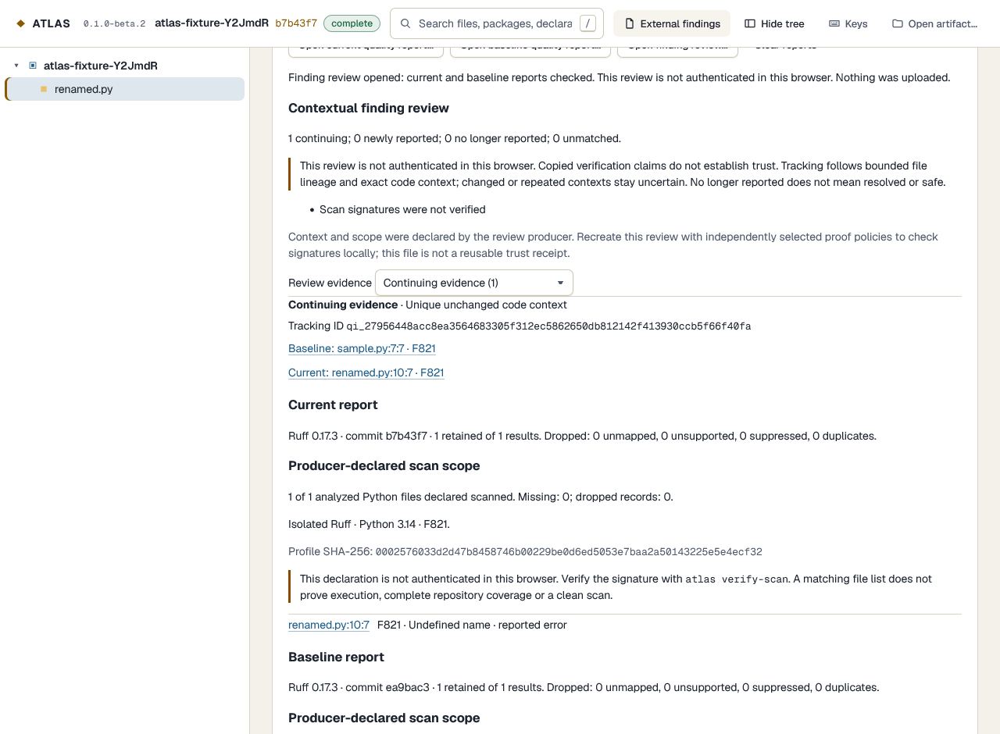

# Track reported findings across code changes

`atlas review-findings` compares two Ruff scan declarations against committed source.
Tracking IDs survive line shifts and accepted renames when code context stays unique
and unchanged. Duplicates, changed context and incomplete evidence stay uncertain.
**No result is labeled resolved, safe or lint-clean.**

This local extension builds on [Ruff import](external-findings.md) and
[scan provenance](scan-provenance.md). It runs no scanner, repository configuration,
Python, hooks or dependencies. Nothing uploads automatically.

## Prepare and compare

Create **one history artifact** containing an earlier baseline and a later current
commit as sampled frames. Inspect it to check their full commit IDs. A HEAD-only
artifact cannot supply both frames. The external producer must scan the corresponding
committed Python bytes and bind both `atlas.scan/1` subjects to that same artifact.
Today's working tree cannot stand in for an old commit. Do not rebind signed reports.
Independently generated analyses and long-term issue databases are outside this increment.

Keep the local Git objects for both commits. ATLAS checks real first-parent order,
commit parents, file/blob inventories and read source hashes. Missing objects fail;
there is no automatic fetch or working-tree checkout.

```sh
atlas review-findings current.scan.json --baseline baseline.scan.json --artifact atlas-history --repo path/to/repo --out finding-review.json --json
```

A new `atlas.finding-review/1` outside the immutable artifact contains both normalized
quality reports, scan byte digests, declared profile/coverage, source-free anchors and
tracking rows. No source, original messages, machine paths, fixes or author data.
Hashes are identifiers, not encryption or anonymity; paths/fingerprints still disclose
structural information when shared. Input/output is capped at 8 MiB; exceeding it
fails without sampling or overwriting a previous file. Unsigned review returns **2**.

## Tracking and uncertainty

The same analysis, bounded file lineage, Ruff version/profile, rule and column produce
the same ID when the exact finding line plus two neighbors on each side form a unique
unchanged context. Severity and line/rename positions may change. Preserve whitespace,
case and Unicode; only CRLF terminators normalize. This is evidence continuity, not
semantic equivalence or permanent identity. Code outside that five-line window is not
represented by the fingerprint.

Repeated context, unknown columns, long/unavailable context and source budgets use
blob/location identity instead: stable only while blob and position stay identical.
Copies and delete/recreate do not inherit identity. Nearby edits can therefore leave
even likely fixes unmatched. Across frames of one artifact, IDs require no mutable ledger.

| Row | Meaning |
|---|---|
| Continuing evidence | Unique context or identical blob/location matches on both sides |
| Newly reported | Comparable authenticated declarations report a previously unreported occurrence at identifiable unchanged context/location |
| No longer reported | Comparable authenticated declarations omit a formerly reported occurrence whose context/location remains identifiable; not resolution |
| Unmatched current/baseline evidence | Changed/repeated context, absent Python lineage, partial scope, mismatched semantics or missing authentication prevents stronger accounting |

## Check both signatures locally

Select two **independently reviewed** directories, each with `bundle.jsonl`, `trust.json`
and `trusted-root.jsonl`. Producer-supplied policy/root must not become its own authority.
`trust.json` accepts the original `atlas.scan-trust/1` direct-scan policy, retaining its
requirement that producer source equals the scan commit. A current job scanning old
Git objects instead needs an explicit two-pin historical policy:

```json
{
  "format": "atlas.review-scan-trust/1",
  "scanCommit": "0123456789012345678901234567890123456789",
  "producer": {
    "format": "atlas.scan-trust/1",
    "repository": "YOUR_ORG/YOUR_REPO",
    "workflow": ".github/workflows/review-scans.yml",
    "workflowCommit": "abcdef0123456789abcdef0123456789abcdef01",
    "sourceCommit": "abcdef0123456789abcdef0123456789abcdef01",
    "sourceRef": "refs/heads/main",
    "trustedRootSha256": "0123456789abcdef0123456789abcdef0123456789abcdef0123456789abcdef"
  }
}
```

Replace example values with reviewed metadata. `scanCommit` pins the historical subject's
target; `producer.sourceCommit` pins the attested producer checkout. A certificate for
today's workflow does not certify that its checkout was yesterday's commit. The approved
workflow asserts which historical bytes it scanned; the signed manifest and local Git
references bind that assertion. The existing `atlas verify-scan` direct mode is unchanged.

```sh
atlas review-findings current.scan.json --baseline baseline.scan.json --artifact atlas-history --repo path/to/repo --out verified-review.json --current-proof approved-current --baseline-proof approved-baseline --json
```

Both proof directories or neither are required. GitHub CLI 2.102.0 is an optional
prerequisite; `--gh` accepts an explicitly trusted absolute executable. All root/OIDC/
hosted-runner/workflow/source policy, local-input and process bounds from the
[provenance guide](scan-provenance.md) apply independently. Failed proof writes no review.
Original scan bytes are never silently rewritten.

Comparable declarations require the same Ruff version/profile, complete declared
included-Python scope without dropped records, and approved producer repository/
workflow/ref/root identity. Producer revisions may differ; each is pinned and reviewed
independently. This does not prove identical transitive code or truthful scan execution.

Exit **0** means comparable declarations and no unmatched rows, even when findings
remain. **2** means useful but uncertain; **1** failure, **64** usage, **130** cancellation.
No clean, vulnerability, resolution or merge verdict. Stored `declaredTrust` and
`declaredVerification` are declarations, not reusable cryptographic receipts. Command
JSON separately states whether this invocation actually checked both signatures.

## Browser and CI

Choose **External findings → Open finding review…**. Both reports replace the prior
pair only after validation; invalid imports preserve it. Filter rows and use Baseline/
Current links to select the correct snapshot/file and Findings tab. The inspector uses
the appropriate report. Older exact-location comparison is hidden during contextual review.

The browser always says **not authenticated**, even for copied claims of verification.
It neither launches GitHub CLI nor accepts a trust badge from JSON. Individual report
import clears contextual review. Clear/reload/artifact replacement discards the session;
files never upload or save automatically.



[The producer](../../scripts/produce-finding-review.mjs) defaults to this trusted ATLAS
repository; `--repo <local-path>` explicitly selects another repository as data, using
its committed HEAD rather than the producer job's checkout SHA. Output always stays in
the tool checkout's `.atlas-tmp`. An explicit full baseline must be within the mainline window
(200 commits/90 days). It creates two frames, copies hash-checked committed Python blobs
into private scratch and invokes supplied Ruff 0.17.3 in isolated mode. It requires
1..100 Python files/frame and at most 1 MiB/blob, 64 MiB combined source. Python never runs.

[The signing recipe](../examples/finding-review-attestation.yml) remains outside active
workflows pending owner review/copy/merge/dispatch. It signs both scan subjects from
the current producer revision and retains their matching source-free artifact. Consumers
choose historical-target policies independently. Raw SARIF/source under `private/` must
never be uploaded. Artifact sharing exposes paths/metrics/relationships. The initial
review file stays unsigned; consumers recreate it with their proof policies.
No live ATLAS signed historical scan proof is claimed yet.

The read-only verifier CI job exercises the real producer/Ruff on a deterministic
three-commit fixture with networking disabled and no signing permissions. It asserts
the original positions, rename/line-shift match and unchanged Git metadata. This
avoids turning an aged or shallow ATLAS checkout into a vacuous producer test.
Actual signature verification uses the separate authentic
vendor fixture; orchestration mocks are not cryptographic evidence.

Review indexing caps: 1 MiB/blob, 64 MiB total, 200,000 context windows, 16 KiB/context,
4,096 findings/side and 8,192 rows. Over-budget context is unavailable, not sampled.
Native reads batch at most 64 blobs/8 MiB. Human/device/site G6/R6 acceptance stays open.

[Decision](../adr/ADR-087-contextual-finding-review.md).
