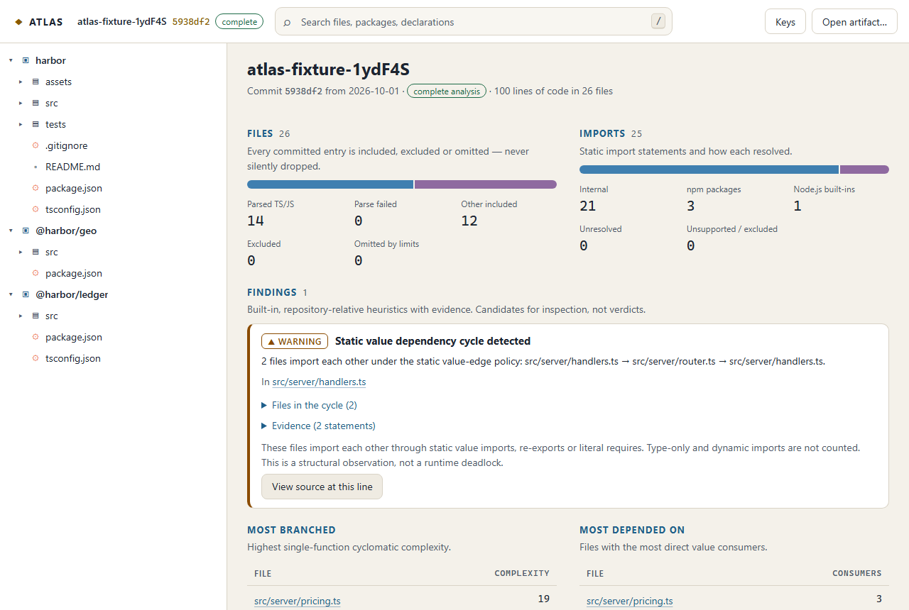
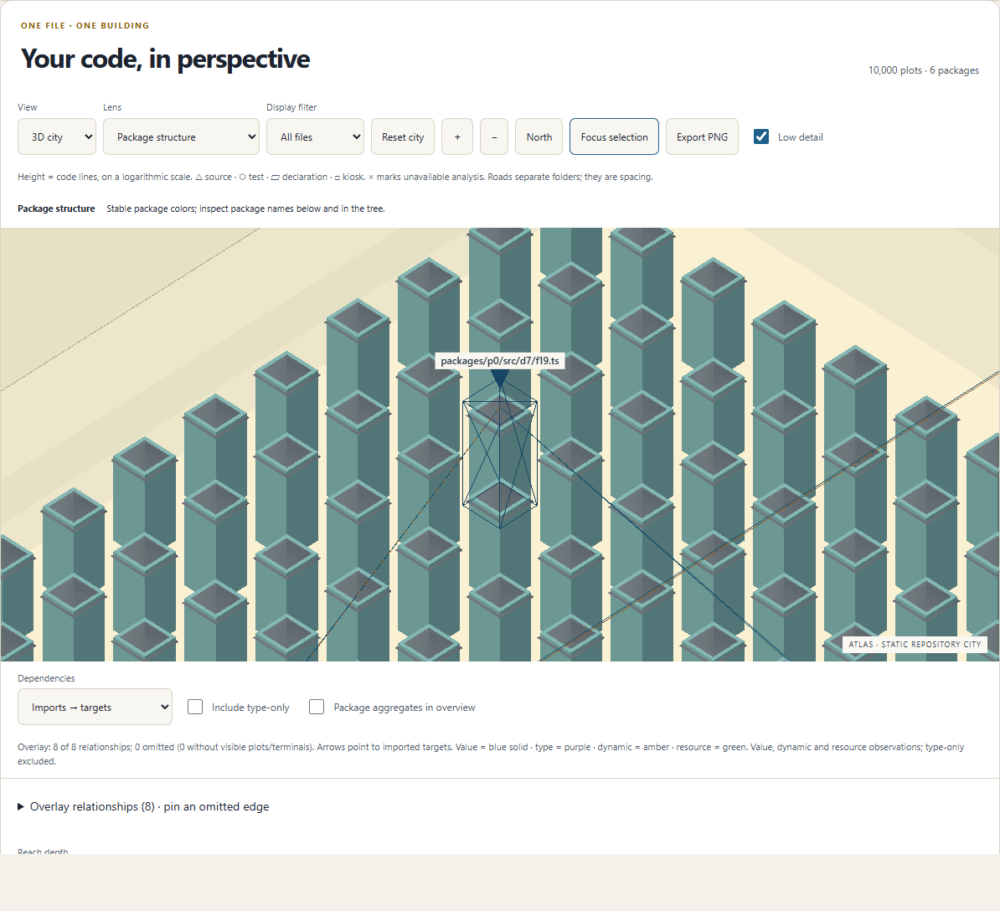
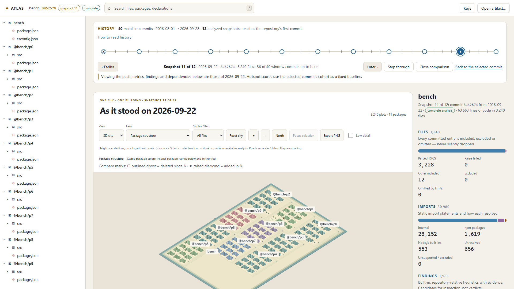
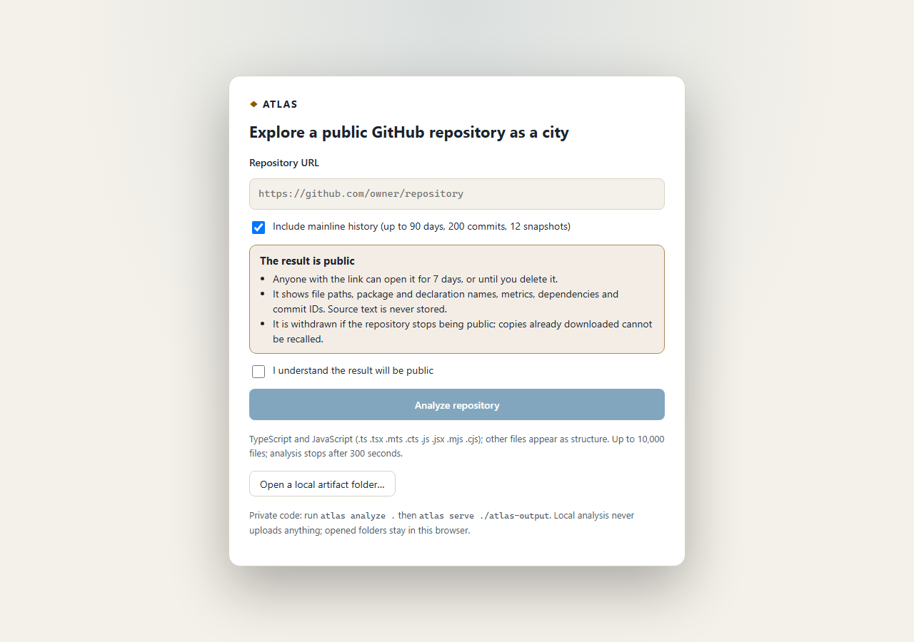

# Implementation status

Maintained per plan §20.1. A task is **done** only when its completion evidence exists and its checks pass.

**Current milestone (2026-10-11):** the four product pillars and Phase 6 candidate tooling are implemented. Evidence includes the real corpus, the portable CLI candidate and the 20-sample near-limit large-history gate under 4 CPU/2 GiB (p95 202.37 s, [ADR-037](adr/ADR-037-export-hashing-and-structural-proofs.md)). All eight CI jobs pass on `7480ad6`. G6 remains open for the exact dense/temporal capacity-fixture matrix, human, reference-hardware and deployment acceptance items R6-01…R6-07 in the [release audit](release/release-audit.md). Runtime instrumentation remains deferred. Agents: read [AGENTS.md](../AGENTS.md).

## Phase 0: prove constraints and lock contracts

| Task | Status | Evidence | Checks |
|---|---|---|---|
| P0.1 Toolchain/skeleton | Done | 13 workspace packages matching plan §5.3; strict TS (`tsconfig.base.json`); exact pins in [toolchain.md](toolchain.md); [ADR-013](adr/ADR-013-pin-typescript-6-compiler-api.md), [ADR-014](adr/ADR-014-toolchain-and-library-pins.md); CI on Ubuntu and Windows (`.github/workflows/ci.yml`) | `pnpm typecheck`, `pnpm check:deps` (declared deps, source imports, runtime-instrumentation ban; negative case verified) |
| P0.2 TS resolver spike | Done | `packages/analyzer-ts`: syntax facts, require shadowing, virtual FS host, config discovery with bounded `extends`, workspace map, precedence rules 1–7. Decisions in [ADR-015](adr/ADR-015-resolver-context-policy.md) | `analyzer-ts/test/extract.test.ts` (9), `resolve.test.ts` (39 hand-written expectations) |
| P0.3 Safe Git/object spike | Done | `packages/ingest`: generated metadata dir, scrubbed environment, ref resolution without revision syntax, tree/blob/commit/diff readers, process-tree kill, GitHub URL admission, filtered acquisition, explicit blob broker. Results in [ADR-016](adr/ADR-016-safe-git-acquisition-spike-results.md) | `ingest/test/local-git.test.ts` (27: traps, worktrees, alternates, SHA-256, adversarial trees, timeouts); `github.test.ts` (39 offline + 2 live, run with `ATLAS_NETWORK_TESTS=1`) |
| P0.4 Instancing/layout spike | Done | `packages/layout`: square-shelf packer v1, heights, xorshift32 seeds. `apps/web` spike: one InstancedMesh per batch, ID picking, HTML fallback. Report in [benchmarks/phase0-render-spike.md](benchmarks/phase0-render-spike.md) | `layout/test/pack.test.ts` (hand-computed reference, 150 randomized trees, order independence, 20k plots ≈ 30 ms); `pnpm spike:render` |
| P0.5 Contracts/fixtures | Done | `packages/schema` runtime contracts and semantic validators; generated JSON Schema (`packages/schema/generated/`) and OpenAPI (`docs/api/openapi.json`); handcrafted artifact; Harbor demo repository (12 real commits) with independent expectations; [contracts docs](contracts/) | `schema/test` (34), `test-fixtures/test/handcrafted.test.ts` (23), `analyzer-core/test/first-session.test.ts` (6); `pnpm contracts:check` |

### Gate G0 assessment

| Fundamental question | Answer and evidence |
|---|---|
| Can source be read safely? | Yes. Committed objects only, via an ATLAS-owned Git dir. Armed hooks, filters, textconv, external diff, helpers, aliases and an `ext::` promisor remote never execute, and a control run proves the traps were live. Missing objects are reported, never fetched. |
| Can supported imports be classified correctly? | Yes, for the declared matrix: 39 resolver expectations plus the full Harbor demo match hand-written outcomes, including Node-vs-bundler differences and workspace/alias cases. Non-compiler inferences are labeled. |
| Can the supported size be rendered? | Yes, on the recorded device. 10k and 20k buildings render in 2 draw calls; p95 frame time 17.8 ms (vsync-bound); 271/271 picks correct; heap 22–29 MiB; WebGL-absent and context-loss fallbacks show HTML. |

Open items carried forward (none block G0):

- External egress, DNS and container caps for hosted acquisition: Phase 5, P5.3 (ADR-016 interim limits).
- Render budgets on the plan's reference device class, plus Firefox: P3.6/P6.2.
- ~~Cross-checking generated JSON Schema with an independent validator: P1.1.~~ Done in P1.1 (Ajv 2020).

## Phase 1: reliable ingestion and structural artifacts

| Task | Status | Evidence | Checks |
|---|---|---|---|
| P1.1 Canonical schema package | Done | ID re-derivation for nodes, edges and observations (`verifyIds`); coverage arithmetic (included + excluded + omitted = discovered; supported + opaque = included); `validateArtifactBundle` cross-checks manifest ↔ graphs ↔ history ↔ layout; cumulative byte caps in the loader | `test-fixtures/test/contracts.test.ts` (19): golden canonical hashes, Ajv 2020 validating the generated JSON Schemas, ID tampering, bundle cross-reference corruptions |
| P1.2 Safe committed inventory | Done | `analyzer-core/src/inventory.ts`: canonical UTF-8 byte order, lazily batched blob reads, built-in/repository/CLI exclusions, roles, LFS/binary/encoding/Flow/oversize/source-budget accounting, file limit. Rules in [ADR-017](adr/ADR-017-inventory-scope-and-hierarchy-rules.md) | `analyzer-core/test/inventory.test.ts` (79): 35 adversarial entries with hand-written outcomes, limits, determinism, glob semantics, role classification, config validation |
| P1.3 Package/config discovery | Done | `analyzer-core/src/hierarchy.ts`: root and synthetic packages, pnpm/npm workspace globs with negation, exact folder chains, `declares-package` and `project-reference` edges, config and workspace warnings; ambiguous names never guessed | `analyzer-core/test/hierarchy.test.ts` (7), `analyze.test.ts` (6: Harbor hierarchy, reproducibility, cross-platform golden, partial status) |
| P1.4 Artifact I/O | Done | `packages/artifact`: canonical chunks with fixed-metadata gzip; one bounded loader for Node (`directorySource`) and browsers (`pickedFilesSource` + `DecompressionStream`); atomic staging/backup publication with crash recovery | `artifact/test/artifact.test.ts` (19): round trip, browser path, flipped byte, truncation, missing chunk or manifest, gzip bomb, traversal, foreign major, non-canonical JSON, symlinked chunk, refuse/replace/protect, recovery after a crash at either point |
| P1.5 Minimal CLI | Done | `packages/cli`: `doctor`, `analyze`, `inspect` (terminal city plan from the layout chunk), `verify`; exit codes 0/1/2/64/130; committed-only and sharing notices; `repository-id.json` reuse and `--previous`; `--json` NDJSON | `cli/test/cli.test.ts` (19): no network attempts, `.git` byte-identical before/after, uncommitted file invisible, overwrite/replace/identity, partial exit 2, cancellation 130, usage errors 64, corrupt artifact, Gate G1 fixture through the CLI, real binary |

### Gate G1 assessment

| Requirement | Evidence |
|---|---|
| Correct package/directory/file hierarchy | Hand-written hierarchies for the monorepo fixture (`hierarchy.test.ts`) and Harbor (`analyze.test.ts`, `cli.test.ts`) |
| Explicit omissions for all inventory fixtures | Every one of the 35 fixture entries is included, excluded or omitted with its expected reason, both through the library and through `atlas analyze` + `atlas inspect --json` |
| Artifacts reproducible | Identical chunk hashes across runs and via `--previous`. Golden canonical hashes for the handcrafted artifact and Harbor pass in CI on Windows and Linux |
| Safe to import | The bounded loader rejects every corruption class in plan §16.1 "Artifacts" before any rendering code runs |

The CLI end-to-end suite passes on Windows and Linux in the linked CI run.


## Phase 2: static analysis, graph and functional viewer

| Task | Status | Evidence | Checks |
|---|---|---|---|
| P2.1 Parser facts | Done | Supported TS/JS imports/declarations/ranges, text and token line counts, per-callable cyclomatic contributions, nested callable isolation, malformed/deep syntax failures | `analyzer-ts/test/extract.test.ts`, `complexity.test.ts`; no partial-AST dependency claims |
| P2.2 Resolver implementation | Done | Compiler host accesses only the indexed virtual tree/config/workspace map; explicit inferred/exact confidence and unresolved reasons | `analyzer-ts/test/resolve.test.ts`; real filesystem/network instrumentation reports zero calls, with an armed filesystem control |
| P2.3 Graph aggregation/queries | Done | Grouped evidence, indexed adjacency, unique degree, package rollups, deterministic iterative SCC/witness, search and bounded reach | `graph/test/graph.test.ts`; 20k-node and 100k-edge internal fixtures (the product's included-file cap remains 10k) |
| P2.4 Metrics/rules | Done | Hand-defined line/complexity/degree metrics; shared rule catalog and authored explanations; source/observation/member evidence | `analyzer-core/test/analyze.test.ts`: Harbor expected imports, degree, one cycle/witness, findings, null history; independent complexity tests |
| P2.5 Parser isolation/cache | Done | Bounded child pool, timeout/process-tree kill, crash/OOM handling, deterministic merge, verified serializable fact caches | `analyzer-core/test/parse-pool.test.ts`; timeout child proven gone; malicious/corrupt cache rejected |
| P2.6 Functional viewer/serve | Done | Tree/search/inspector/dependency/findings/source/deep links; browser-only artifact open; loopback session, Host/Origin and file boundaries | `cli/test/serve.test.ts` (13 security tests), `viewer.e2e.test.ts` (8 browser journeys); browser prerequisites enforced in CI |
| Phase 2 transport gate | Done | Lossless indexed graph format preserving canonical IDs and evidence; legacy imports; separate wire/decoded limits and hashes | [ADR-018](adr/ADR-018-indexed-graph-transport.md); `artifact/test/indexed-graph.test.ts` (15), existing artifact/security fixtures, generated JSON Schema |

### Gate G2 assessment

| Requirement | Evidence |
|---|---|
| Find a file | Keyboard-only search and synchronized tree/inspector browser journey |
| Inspect direct dependencies and limitations | Independent Harbor targets/counts; type/dynamic/external/context labels; keyboard navigation follows real targets |
| Explain a finding | Cycle witness, raw metrics, static edge policy and authored limitations in the findings inspector |
| Functional source/artifact paths | Verified committed source; unattached source remains unavailable; file-picker loading performs no upload |
| Medium analysis and size | [20-run report](benchmarks/phase2-analysis.md), cold fact cache after one warm-up: p50 8.21 s, p95 8.38 s, worst 8.57 s; artifact 2,146,223 bytes (2.05 MiB). Both original targets pass |
| Preserve deterministic/full-ID graph | Exact indexed/plain/browser round trips, canonical hash and semantic validation; no dropped declarations/evidence |
| Complete checks | `pnpm verify` with `ATLAS_REQUIRE_BROWSER_TESTS=1`: 20 test files, 417 tests passed on local Windows and both CI platforms; 2 live-acquisition tests opt out of the main suite and pass in the separate live CI job (41/41). Generated contracts, strict source/test/viewer type checks, build and dependency direction pass |



Decisions and remaining boundaries: [ADR-019](adr/ADR-019-phase2-static-analysis-and-viewer.md). The production 3D city/accessibility/device budgets remain Phase 3; sampled Git history/churn/hotspots remain Phase 4; hosted egress/container/publication gates remain Phase 5. The functional viewer is not represented as the finished 3D product. Reference-class GPU performance, external 2 GiB hosted enforcement and real-repository coverage remain later measured gates.

Cross-platform verification also corrected two test assumptions: linked-worktree paths are compared after filesystem resolution so Windows short paths and expanded paths identify the same directory; the keyboard-only cycle journey inspects both member files and validates source opening whether the diagnostic subject is selected or another member is selected. Production analysis and viewer behavior are unchanged by these corrections.

## Phase 3: miniature city and synchronized navigation

| Task | Status | Evidence | Checks |
|---|---|---|---|
| P3.1 Production layout | Done | Canonical integer rectangles and seeded styling; layout 1.1 perimeter anchors; stable package colors | Authored gate/routing/metric references, randomized containment/order tests, dense integer anchors and 20k union benchmark |
| P3.2 Instanced renderer | Done | Lazy Three.js owner; shared role geometry, code-line heights, bounded orthographic camera, spatial picking, on-demand frames, explicit disposal | Small/medium/large three-lens and close-up references; actual building pick; context failure; 20 map/3D replacement cycles |
| P3.3 Navigation synchronization | Done | Shared search/tree/city/table/inspector selection; explicit camera focus; validated fragments; retained validation/query worker | Real browser keyboard journeys, rapid search and stale worker results, fragment round trips, disposal/deadline tests |
| P3.4 Lenses and overlays | Done | Structure/complexity/fan-in raw legends; directed typed arcs, package rollups, 200-arc cap/pinning, 50-terminal sampling/promotion and complete HTML lists | Independent incoming/outgoing/type counts, 210-edge hub, external overflow, unknown versus zero, static reach bounds |
| P3.5 Accessibility/responsive | Implementation + automated checks done; manual audit pending | Semantic paged HTML, keyboard controls, 44px targets, 320px reflow, reduced motion, touch pan/pinch, map/context fallback | Zero automated WCAG AA violations; keyboard/canvas-disabled task journeys; native touch events; Firefox functional check; human audit protocol below |
| P3.6 Export/performance | Implementation + local measurements done; device audit pending | Bounded PNG/provenance, LOD, worker-owned queries/indexes, lazy renderer and optimized strict validation | Full 20-run [production report](benchmarks/phase3-city.md), 10 Mbps cold route, joint 10k/100k dense fixture, main + worker heap, disposal; exact reference-device repeat remains pending |

### Gate G3 evidence and unresolved release checks

The [raw report](benchmarks/phase3-city.json) stores individual samples, fixture commits, layout IDs, actual environment, errors and gate flags. It is a full acceptance invocation, rather than a one-run smoke test. Real committed repositories are analyzed and exported, then loaded through the production validation worker and loopback server. No graph mock replaces ingestion. The 10,000-file fixture has 99,975 edges. The medium cold route, post-chunk useful load, search, selection/overlay, camera, draw calls, retained combined JS heap and resource-cycle budgets pass on the recorded GT 730 desktop. The dense interaction/camera traces include one 52ms task. A separate [20-run CPU attribution follow-up](benchmarks/phase3-interaction-profile.json), with fresh imports, recorded no long tasks; no repeated blocking work was identified. The original outlier remains unattributed and is preserved for reference-device review. Startup validation and cloning are included in load times, not that long-task trace.

Heap interpretation is explicit: retained main + owned worker data stays below 300 MiB after collection, while pre-collection allocations can exceed it. This is not a 300 MiB process or startup peak guarantee. [ADR-024](adr/ADR-024-decoded-artifact-capacity.md) documents this capacity tradeoff; native GPU memory/RSS and lower-memory devices need separate measurement. Adjacent historical frames are not loaded in Phase 3 and must be budgeted in Phase 4.

[Phase 3 Windows/Linux CI](https://github.com/urveesh09/project-atlas/actions/runs/38063413034) passes commit `f10edf4`. Local full verification at Phase 3: 24 test files, **450 passing tests**, 2 opted-out live acquisition tests; strict library/test/viewer types, production build, dependency direction and generated contracts all checked. The browser suite includes 18 production journeys; legacy artifact import, cumulative byte limits, independent canonical identity/hash references and worker lifecycle tests remain passing. CI software rendering verifies behavior, not reference-device performance.




Decisions: [ADR-020](adr/ADR-020-production-city-viewer.md) viewer ownership; [ADR-021](adr/ADR-021-bounded-external-ring.md) perimeter; [ADR-022](adr/ADR-022-canonical-validation-performance.md) byte-preserving optimizations; [ADR-023](adr/ADR-023-retain-validated-query-worker.md) worker handoff; [ADR-024](adr/ADR-024-decoded-artifact-capacity.md) versioned capacity.

### Human/device audit protocol

These checks require human assistive-technology use and hardware not available to the automated suite. Record operator, OS/browser/screen-reader versions, fixture commit and pass/fail evidence; do not mark them done from axe results.

1. With NVDA on Windows/Chromium or VoiceOver/Safari, perform artifact open, search and result selection, tree navigation, file dependency/evidence inspection, finding explanation, source open, lens change, map/table switch, omitted-edge pin and static reach query. Confirm announced names, current selection, loading/limits/errors, focus order and recovery with canvas disabled; check no trap or excessive live announcements.
2. At 200% and 400% zoom/320 CSS pixels, repeat core tasks with keyboard and reduced motion. Tables may scroll inside their own regions; page controls must reflow. Check text, focus, unknown metrics and selected role identification without color.
3. Run `bench-city.mjs --firefox` on the plan's reference integrated-GPU device after a clean build, retaining the complete 20-sample report. Record OS, GPU/driver, browser, DPR, hardware and memory. Inspect startup/pre-collection heap and native GPU/RSS in addition to retained data; profile any >50ms interaction tasks. Keep original latency/frame budgets.
4. Repeat export and context-loss/fallback recovery on that device and inspect all lens/role references. Document findings before G3 release sign-off. History/compare acceptance belongs to Phase 4.

## Phase 4: Git evolution and stable temporal city

| Task | Status | Evidence | Checks |
|---|---|---|---|
| P4.1 Bounded mainline history | Done | Safe batch commit walk/diffs; root, merge, date skew, day/commit and shallow boundaries; explicit unavailable changes | Real Git fixtures plus local security traps; observed/requested window assertions |
| P4.2 Lineage/frame selection | Done | Conservative rename continuity, ambiguous duplicates and delete/recreate; unsampled changes processed; sampled chain indices | Authored history fixtures, rename between frames and clock-skew cases |
| P4.3 Historical graph reuse | Done locally | Shared parser/fact/blob cache; selected graph preserved on historical failures; over-cap frames unavailable; bounded lossless transport | Exact Node/browser frame round trips, hostile deltas/compact runs, per-frame capacity regression; hosted checkpoint recovery remains P5.3 |
| P4.4 Churn/hotspots/co-change | Done | Prior-frame-only churn, fixed HEAD cohort, null/partial metrics, nearest-rank findings and bounded co-change | Independent hand-computed activity, Jaccard, ties/interpolation and no future-churn leakage |
| P4.5 Union layout/compare | Done | Latest-path anchors, identical plots, historical current membership; projected graph/raw metric differences | Coordinate invariance, moved-file memberships, additions/deletions/renames, unavailable metric sides |
| P4.6 History UI | Done locally | Sampled keyboard strip, lazy frames/LRU, tombstones, A/B ghosts/markers, churn/hotspot lenses, history/source/deep links | Nine real-browser history journeys, reduced motion/320px/automated AA; worker replacement and comparison-navigation regressions |

### Gate G4 verification

The independent initial full suite passed 524 tests. Review added worker response isolation, current comparison-B synchronization, request-scoped decoder cache ownership, the three-link delta bound, partial co-change and shared blob-budget regressions, and a regression preventing an over-cap historical frame from being rendered as a shortened snapshot. All 528 local-product tests pass (29 files, two live-acquisition tests opt out); strict types, production build, dependency direction and generated contracts pass. [ADR-028](adr/ADR-028-phase4-review-and-cache-ownership.md) records those corrections and the dev.5 identity/golden update.

Performance evidence: [historical analysis report](benchmarks/phase4-history.md) and [snapshot-change/combined-heap report](benchmarks/phase4-history-viewer.md). The dev.5 artifact is 4,924,526 bytes (4.70 MiB), within the 5 MiB target. Cached snapshot changes pass at 135.5 ms p95 across 20 samples; four retained main/worker sweeps stay at 208.38–208.71 MiB and two non-HEAD frames compared retain 226.41 MiB, below 300 MiB. Cold first visits reach 11.29 seconds; pre-collection combined allocations reach 657.34 MiB. These are explicit costs, not hidden by cached or retained measurements.

The [earlier transport report](benchmarks/phase4-history-precompact.md) failed size. The [contended timing batch](benchmarks/phase4-history-contended.md) passes size but fails latency at 101.75 s p95; full verification overlapped two runs. Both are preserved. The final unloaded 20-run dev.5 repeat passes: p50 **68.82 s**, p95 **69.59 s**, maximum **69.59 s**, against 90 seconds. No local tests or viewer profiling competed with that batch. Reports record actual hardware, fixture identities and individual samples; exact reference-device performance remains a release audit.

[Phase 4 Windows/Linux CI](https://github.com/urveesh09/project-atlas/actions/runs/38076541930) passes implementation commit `995acb3`, including live acquisition and the software-rendering check. The full local verification also exercised the separately committed Phase 5 foundation below.

All four local pillars are implemented. Historical omission/window/anchor semantics are visible; missing history never becomes a measured zero. The selected graph is an in-memory local checkpoint and local output publication is atomic. Durable recovery of a crashed hosted sandbox remains P5.3 and is not claimed by the local implementation.

Decisions: [ADR-025](adr/ADR-025-history-semantics.md), [ADR-026](adr/ADR-026-frame-delta-and-compact-transports.md), [ADR-027](adr/ADR-027-viewer-frames-and-history-ui.md), [ADR-028](adr/ADR-028-phase4-review-and-cache-ownership.md). Human assistive-technology and reference-hardware audits remain release checks; the protocol above extends to timeline, tombstone and A/B comparison tasks. Runtime tracing remains fully deferred.



## Phase 5: hosted public GitHub service

The hosted service is implemented end to end. Analysis uses the same analyzer, contracts and viewer as the local route, and the mandatory hosted security gates pass on a real Linux container engine.

| Task | Status | Evidence | Checks |
|---|---|---|---|
| P5.1 API admission and auth | Done | Exact GitHub-root validation; numeric identity, visibility and commit ancestry through the pinned, budgeted client; sessions and one-time hashed capabilities; idempotency (200 on a completed replay); quotas; queue position; `createdAt` | 21 admission integrations on PostgreSQL; live pinned-client checks |
| P5.2 Queue and worker leases | Done | Database fencing (ADR-029), wired to the coordinator: 1 s cancellation poll, 10 s heartbeats, deadline stop, fenced completion, one retry, scratch sweeper | Queue races; coordinator cancellation at all four stages; crash and retry; cancellation winning over publication |
| P5.3 Isolated acquisition and analysis | Done | Broker, acquisition and analysis containers from one pinned image; DNS-pinned CONNECT broker with byte budget; framed untrusted output with independent verification; durable HEAD checkpoint and PARTIAL fallback; reconciliation | Sentinel, network-isolation, lazy-fetch, live-broker and resource gates (ADR-030/031); 55 egress unit checks |
| P5.4 Publication and storage | Done | Private filesystem and S3 (SigV4) stores; uploads before rows; read-back verification; content-keyed objects; complete-only cache; per-chunk access checks; 5-minute visibility; revocation, expiry, deletion, purge, garbage collection, reconciliation | Lifecycle suite under a simulated clock; real S3 gateway; token isolation; storage outage |
| P5.5 Hosted flow and SSE | Done | Landing with a public-output notice; job page with stage counts, queue, elapsed time, warnings, cancellation and retry; SSE with polling fallback; immutable `/a/<id>`; owner deletion; lifecycle screens; same validating worker | Six Chromium journeys with WCAG 2.2 AA audits; no token or session in any URL |
| P5.6 Deployment and runbooks | Done (development and rehearsal) | API and sandbox images; compose stack; `_FILE` secrets; least-privilege API and worker roles; trusted-proxy client identity; operator metrics endpoint; `atlas-ops`; [operations guide and runbooks](hosted-operations.md) | HTTP journey under least-privilege roles; [operator rehearsal](benchmarks/phase5-rehearsal.md) |

### Gate G5 assessment

**Same analyzer, contracts and viewer on both routes.** Sandboxes run `analyzeCommit` with the release profile. The browser loads hosted chunks through the validating worker used for local artifacts.

**Mandatory hosted security gates (plan §16.3).**

| Gate | Evidence |
|---|---|
| Repository scripts never run | Committed traps and an armed remote; no sentinel appears |
| No outbound connectivity during analysis | Network `none`; probes; missing-blob lazy fetch fails explicitly with no new objects |
| Adversarial URL, redirect, DNS and path inputs | URL corpus; broker host, port, IP-literal and private-DNS refusals; redirects never followed |
| Enforced caps outside the analyzed process | cgroup memory, PID, CPU and scratch limits, OOM and deadline kills (ADR-030); the API stays a separate process |
| No secrets or source traces | Published bytes, logs and job state carry no author identity, absolute or sandbox path, token or repository name |
| Capability isolation | Capability A cannot delete B; a stale lease cannot publish; a private or revoked repository exposes neither manifest nor chunk |
| Cross-origin and upload safety | Cross-origin mutations rejected; browser-only opening never uploads (Phase 2 test) |
| Scratch, expiry and revocation | Checked under a simulated clock and a crash |

No private-repository support and no automatic local upload were added.

**Fixed during review.**

- A missing blob became a zero-byte opaque file; it is now `LOCAL_OBJECT_MISSING`.
- The pinned TLS socket was bypassed through `agent: false`.
- The pinned client's byte accounting did not count TLS bytes.
- Least-privilege admission was missing `UPDATE` on `sessions`.
- The fixture `safe.directory` exception never reached `upload-pack`.
- Files written by uid 10001 in job directories could not be removed by the worker.
- The operator CLI tripped a Windows exit assertion.

**Operator rehearsal.** The [rehearsal](benchmarks/phase5-rehearsal.md) ran in containers, against S3-compatible storage, with the processes under least-privilege roles. All 11 steps passed:

- **Harbor journey:** 8.1 s end to end, all 12 frames verified through the public routes.
- **Cached reuse:** 1.1 s.
- **Medium repository** (3,252 files, 40 commits): READY in **162.2 s** end to end, against the 300 s deadline. The artifact is 4.69 MiB. Within that run, history analysis took 74.3 s and verification 35.2 s.
- **Operator cancellation:** 5.5 s, with no sandbox left.
- **Worker crash:** SIGKILL during HISTORY. The retry recovered from the checkpoint and the job reached READY.
- **Operator purge:** the publication answers 410.
- **Restore:** revocation was preserved.
- **Rollback guard:** an older binary refuses a newer schema.

The machine was the Windows 11 development host: 12 CPUs, Docker Desktop 29.8.1. These figures are not a reference-hardware capacity claim.

**Fresh-environment demonstration.** The `deploy/compose.yaml` stack ran from newly generated secrets: PostgreSQL, the S3 gateway, the migration job with role provisioning, and the API image. Alongside it, the host worker ran in GitHub mode with Docker sandboxes. It analyzed the real public repository `sindresorhus/is-plain-obj` through the egress broker, and the job reached READY in 10.1 s with its manifest served by the containerized API. The stack was then torn down with its volumes.

An earlier attempt in that session failed closed with `UPSTREAM_RATE_LIMITED`, as designed: the anonymous GitHub quota had been spent by the live tests.

**Verification.** Local `pnpm verify` ran with every gate enabled: PostgreSQL, the S3 gateway, Docker containers, live GitHub and Chromium. **672 tests passed across 39 files, with none skipped.** No sandbox container or network remained afterwards. Without services, the integration suites skip explicitly (78 tests in the hosted packages). The `hosted` CI job runs the gated suites on Linux.

**Still release work (P6).** G5's controls all pass in the development and CI environments. Public launch remains open:

- deploying the service on operator infrastructure (domain, TLS, egress firewall);
- reference-hardware capacity runs;
- human assistive-technology audits.

Decisions: [ADR-029](adr/ADR-029-hosted-admission-and-lease-foundation.md), [ADR-030](adr/ADR-030-offline-container-isolation-spike.md), [ADR-031](adr/ADR-031-hosted-acquisition-and-analysis-pipeline.md), [ADR-032](adr/ADR-032-publication-storage-and-lifecycle.md), [ADR-033](adr/ADR-033-hosted-flow-deployment-and-operations.md).



## Phase 6: release candidate verification

**G6 remains open.** Candidate tooling and documentation are implemented while final
human/reference-device/operator acceptance remains pending. See the [release audit](release/release-audit.md)
for requirement traceability and owners/evidence needed; [ADR-035](adr/ADR-035-release-candidate-evidence-and-distribution.md)
records the distribution and evidence decisions.

| Task | Status | Deliverables and acceptance boundary |
|---|---|---|
| P6.1 Real-repository validation | Done, including independent Windows/Linux CI repeats | Three immutable numeric-ID/commit pins; 16 source-authored role/import checks; five cold offline repeats each with exact graph/history/layout canonical and wire hashes; verified source-free exports; [coverage report](release/real-repositories.md); CI compares both OS reports and each against the original committed payload digests |
| P6.2 Capacity/reliability | Development-host evidence added; reference matrix open | Separate 20-run medium and near-limit large HEAD reports; existing 20-run medium history/combined worker heap; actual disk/OOM/timeout/lease/storage/container fault gates; exact dense/large temporal and reference-device measurements remain open |
| P6.3 Usability/accessibility | Automated journeys pass; human reviews open | Existing keyboard/axe/motion/fallback tests and packaged screenshot; [five-developer and assistive-review protocol](release/manual-review.md), no fabricated participant results |
| P6.4 Documentation/distribution | Candidate implemented; task dependencies open | Portable archive, every-file SHA-256 inventory, third-party notices; [relocated offline CLI/browser smoke](release/distribution-smoke.md), [install/demo/privacy guide](release/README.md), [candidate notes](release/release-notes.md); independent reviewer reproduction follows P6.2/P6.3 |
| P6.5 Release audit | Prepared; sign-off open | [Requirements/evidence matrix and acceptance backlog](release/release-audit.md); runtime fully deferred; final no-P0/P1 and human/operator sign-off pending |

The Phase 5 follow-up review adds exclusive same-database Docker-engine ownership
before destructive reconciliation, connection-loss fencing, route-revision isolation,
correct browser cleanup and a final acquisition disk-budget measurement. Windows cold
historical loads are awaited independently of cached-frame performance. [ADR-034](adr/ADR-034-phase5-review-and-exclusive-engine-ownership.md)
details these defects and regression evidence. The prior agent's reported 672-test run
above is preserved as handoff evidence; this review records its own final measurements
separately rather than treating that report as verification of later edits.

**Final local verification (2026-10-11):** `pnpm verify` passed **675 tests across 40
files, none skipped**, with PostgreSQL, S3-compatible storage, the freshly rebuilt sandbox
image, offline Docker probe, Chromium and live GitHub gates enabled. Types, production
viewer, dependency direction and all generated contracts passed. Duration: 250.71 s.
No ATLAS sandbox container or network remained. File-level test concurrency is bounded
to two; production budgets and functional deadlines remain unchanged. The first
unbounded attempt's overwrite timeout and its successful isolated rerun are preserved
in ADR-035 rather than hidden. Final cross-platform CI follows the pushed candidate.
After the independent-suite bootstrap correction, the filtered historical deep-link
regression also passed (1 selected test; the other 26 deliberately filtered), and strict
types passed again. The full CI run checks the committed final test setup.

The medium HEAD batch measures **6.81 s p95**, 1.85 MiB compressed, across twenty
cold-fact-cache repeats. [Full report](benchmarks/phase6-head-capacity.md) includes every
sample and identity. The separate [near-limit large HEAD batch](benchmarks/phase6-large-head-capacity.md)
uses 9,992 files/98,500 import statements and does not claim exact dense temporal capacity.
It passes at **20.59 s p95**, 6.07 MiB compressed, against 60 seconds/20 MiB.
The host is Windows/i5-10400/16 GiB, not the four-core/2 GiB reference environment.

The real corpus includes complete is-plain-obj and Vue results and a useful partial
Vite result. Unresolved generated outputs, unsupported glob/URL/nonliteral observations
and invalid fixtures are disclosed. Five-repeat equality proves determinism; independent
examples cover their authored cases only. The portable CLI candidate extracts away
from pnpm links and passes doctor/analyze/verify/inspect plus a loopback-only browser
city/history/search/dependency journey. Registry audit currently returns zero production
advisories, with its dated [scope and limits](release/dependency-audit.md).

The baseline local portable candidate was built from clean source commit `cabcef46a9c9aea933646f83b7f12699c3e32049`.
All six relocated distribution stages passed; 1,488 files verified, archive 8,692,103
bytes, SHA-256 `d7cddeb3a240fe6c886f6a9b4de9957a949e7f9d8ff0ebbf207b54f7b84cf271`.
Its manifest records `workingTreeDirty: false`; the subsequent evidence commit changes
reports/screenshot/status only. CI produces separate independently built OS candidates.

[Candidate CI 38112425011](https://github.com/urveesh09/project-atlas/actions/runs/38112425011)
passed all eight jobs on `7395fb8`: Windows/Linux full verification and relocated CLI
distribution, mandatory hosted gates, live acquisition, render behavior and five cold
corpus repeats on each OS. The independent comparison matches all three complete
canonical/wire chunk digests and all sixteen source-authored examples across platforms.

The subsequent large-history diagnostic found a cache-lifetime capacity issue: a
260.41 s warm-up and a 3,475.10 MiB parent working-set observation. This is not a
20-run p95 measurement. [The preserved diagnostic](benchmarks/phase6-large-history-precache.md)
and [ADR-036](adr/ADR-036-export-base-cache-lifetime.md) record the correction: discard
derived adjacent-base export rows after their last use while retaining HEAD reuse.
The combined correction streams exact canonical equality/hash work, matches one base
table against one target row at a time, defers indexed working rows and retains only
small base-key projections. A [bounded-parent diagnostic](benchmarks/phase6-large-history-bounded-completion.md)
now completes all twelve frames. Its contended 283.94 s observation is not a p95 pass;
whole-job resource/timing acceptance remains open. No format, identity or budget changes.

[CI 38115803254](https://github.com/urveesh09/project-atlas/actions/runs/38115803254)
passes all eight jobs on `aa85c71`, including exact comparisons against the original
committed corpus payloads on both OSes. The complete physical-gate local run passes
**679 checks across forty files, none skipped**, in 471.48 s with one test-file worker.
Prior parallel runs observed one native pipeline-worker exit and one kernel-OOM-probe
timeout; isolated reruns pass all 22 pipeline and seven sandbox checks. [ADR-035](adr/ADR-035-release-candidate-evidence-and-distribution.md)
records serial physical-gate execution without changing assertions/deadlines/budgets.
An additional property-read regression for the streamed writer and **112 targeted
checks across five files**, plus strict types, pass after that full run.

The refreshed local portable candidate binds clean source `277f59301b6b3b6ad0f166de38b644720d04f82c`:
**8,700,660 bytes**, 1,488 inventoried files, SHA-256
`233f2f883c7ab04bec6cb596aa835a18a1d7105272d9524fedd4f471700477c5`.
All six relocated stages pass, including ten documentation-link checks, complete Harbor
history, keyboard dependency inspection and zero browser errors/outbound requests.
The previous candidate's identity remains recorded above as baseline evidence.

**Large-history whole-job capacity passes under enforced job limits.** On `277f593` the
constrained one-shot diagnostic took 329.24 s (cgroup peak 99.1%). [ADR-037](adr/ADR-037-export-hashing-and-structural-proofs.md)
replaces portable ID hashing with native SHA-256 in Node, and matches and proves delta
rows structurally instead of rendering canonical text. Exact equality is kept, and the
real-corpus payloads stay byte-identical (CI [38122325539](https://github.com/urveesh09/project-atlas/actions/runs/38122325539)).
The [20-sample report](benchmarks/phase6-large-history-container.md) ran inside four CPUs,
2 GiB and no swap, with each run as a fresh production-shaped process. All runs were
complete with twelve frames: **p95 202.37 s** against 240 s; peak 1,919,053,824 bytes,
zero OOM events; 10.43 MiB. A first batch that reused one process and parser pool across
samples was OOM-killed in its second run; it is recorded in ADR-037, not hidden. The
host is the development i5-10400, not the reference machine.

### Verification review after the agent-guide handoff (2026-10-11)

All eight CI jobs on `7480ad6` were independently checked. Review found that
`canonicalValueEqual` accepted an object with an ill-formed Unicode property key,
including when comparing it with itself, although the canonical writer rejected it.
Both structural paths now check keys; regressions cover lone high/low surrogates,
nested/shared objects and arrays, while retaining valid Unicode keys. This restores
ADR-037's existing invalid-input contract; it changes no valid artifact semantics or
version. The canonical suite passes all **44 checks**.

The final `pnpm verify` run passes **684 checks across forty files, none skipped**, in
**472.31 s**, with real PostgreSQL, S3-compatible storage, freshly rebuilt analysis
sandboxes, offline Docker probes, Chromium and live GitHub gates enabled. Strict
types, production build, dependency direction and generated contracts also pass.
Five fresh offline repeats for each of is-plain-obj, Vue and Vite pass all sixteen
independent examples and reproduce the exact committed canonical/wire payload digests;
`check-repository-baseline.mjs` passes for all three. Vite's documented partial
coverage remains explicit; determinism does not relabel it complete.
No ATLAS job container or network remains. All 77 Markdown files have valid local
file links. The guides now retain the exact dense/temporal capacity-fixture work in
R6-01, describe the runner's recorded dirty state accurately, and explain stopping
the fixture coordinator before switching hosted modes. These corrections do not
claim G6 sign-off or introduce scope beyond V0.1.

### City visual refresh (2026-10-11)

At the owner's request the 3D city gained seeded decorative architecture
([ADR-038](adr/ADR-038-decorative-city-architecture.md)):
- eight building archetypes with neighbourhood style families per district;
- procedural windows that fade to the exact lens colour at distance;
- kerbed, stepped blocks, header-strip lawns and trees;
- contact shadows, a diorama shoreline and harbour depots for external terminals;
- rounded package labels with a structure-lens swatch.

Height, lens colour, role roofs, picking, selection and overlays keep their meaning;
the city note and PNG metadata say styling carries no data.

Evidence:
- `pnpm verify`: 37 files, 608 tests passed, 80 service-gated skips, including 4 new
  architecture tests.
- `check-repository-baseline.mjs`: exact for is-plain-obj, Vue and Vite.
- Draw calls: 22–31 for Vue and 16–18 for the 10,000-file city.
- Frame p95: 16.7 ms at the refresh cap.
- Leak check: GPU geometry stays constant across 10 forced-growth frame-swap cycles.

Captures: [overview](images/city-refresh-overview.png),
[quarter](images/city-refresh-quarter.png), [close-up](images/city-refresh-closeup.png).
The 20-run [phase 3 report](benchmarks/phase3-city.md) and its reference images predate
this change and need a rerun of `apps/web/scripts/bench-city.mjs`; P3.6's pending
reference-device audit is unchanged.

### City styles (2026-10-11)

At the owner's request the 3D city offers three decorative styles
([ADR-039](adr/ADR-039-city-styles.md)):
- *Modern city*;
- *Eastern fantasy*: pagodas with upturned eaves on every storey, palace halls on marble
  platforms, vermilion package walls, lanterns, pines and cherry blossom;
- *Western fantasy*: battlemented keeps and round towers, half-timber houses, wizard
  towers, stone town walls, oaks and cypresses.

The style is a per-viewer preference in the city toolbar. It is kept in browser storage,
never in URLs or artifacts, and recorded as `cityStyle` in PNG metadata. Eaves, bands and
battlements take a darker shade of their building's lens colour, and storeys repeat at a
fixed spacing, so taller files gain storeys. Height, lens colour, role roofs, picking and
overlays keep their meaning.

Evidence:
- `pnpm verify`: 37 files, 622 tests passed, 80 service-gated skips, including 18
  style-by-style architecture checks.
- `check-repository-baseline.mjs`: exact for all three real repositories.
- Draw calls: 26–38 for Vue in every style.
- 10,000-file city: 18–24 draw calls and every orbit window at the 16.7 ms refresh cap,
  after reducing eave subdivision removed 33–66 ms windows in the Eastern style.
- Leak check: GPU geometry stays constant over ten forced-growth frame cycles per style.
- Switching style keeps the camera and leaves the URL fragment empty.

Captures: Eastern [quarter](images/city-eastern-quarter.png) and
[close-up](images/city-eastern-closeup.png); Western
[quarter](images/city-western-quarter.png) and [close-up](images/city-western-closeup.png).

### Cinematic camera (2026-10-11)

At the owner's request the 3D city now opens in a *Cinematic 3D* perspective view
([ADR-040](adr/ADR-040-cinematic-camera-and-atmosphere.md)):
- damped orbiting, zoom to cursor and ground panning;
- eased glides for reset, focus and north, which reduced motion turns into jumps;
- real sun shadows that re-render only when buildings change;
- a sky dome, an ocean with fog to the horizon, and style-specific distant scenery: Modern
  headlands and skyline; Eastern karst pillars, floating islands and mist; Western alps and
  a hilltop castle.

*Isometric* remains as a camera option for exact height comparison.

Evidence:
- GPU timer queries located the fantasy styles' cost, and indexing parts and capping town
  walls cut it from about 11.5 to 7 ms per frame.
- Vite and the 10,000-file city: all ten 120-frame orbits per style at the 16.7 ms
  refresh cap.
- Draw calls: 19–36.
- Snapshot change including the shadow update: p95 ≤ 50 ms.
- Leak check: GPU resources stay constant over frame-swap cycles.
- `pnpm verify`: 626 tests passed, 80 service-gated skips; the corpus baseline is exact.
- Viewer e2e: 27 tests pass with the cinematic default, inside `pnpm verify` and in seven
  standalone runs (one under concurrent test load). One standalone run straight after
  `pnpm verify` failed three consecutive tests in the miniature-city suite: overlays, PNG
  export and context loss. It is followed up in the next section.

Captures: [Modern](images/city-cinematic-modern.png),
[Eastern](images/city-cinematic-eastern.png),
[Eastern establishing shot](images/city-cinematic-eastern-establish.png),
[Western](images/city-cinematic-western.png),
[Western street](images/city-cinematic-western-street.png).

### Living city (2026-10-11)

At the owner's request the 3D city is perspective-only and more lifelike
([ADR-041](adr/ADR-041-living-city.md); supersedes ADR-040's camera choice):
- a noise-octave sea with Fresnel sky reflection, sun glitter, shallows and beach foam;
- drifting clouds and swaying trees with soft clustered canopies;
- Eastern palace halls on marble terraces, lotus ponds with arched bridges, paifang gates
  and a curved pavilion source roof;
- Western fortresses with turrets, manors with chimneys and shutters, pinnacled chapels and
  gatehouses;
- Modern glass lobbies and rooftop plant.

Ambient motion runs only on hardware GPUs, outside low detail and reduced motion. It runs at
24 fps when idle, pauses when hidden or measured, and yields for 1.5 s to typing and clicking
elsewhere on the page.

Evidence:
- `pnpm verify`: 627 tests passed, 80 service-gated skips; the corpus baseline is exact.
- Vite and the 10,000-file city: all 120-frame orbits per style at the 16.7 ms refresh cap,
  also after 30 s of idle animation.
- Draw calls: 21–42.
- Snapshot change: p95 ≤ 46 ms.
- Search-to-inspector selection: p95 37–38 ms (budget 100 ms).
- Leak check: GPU resources stay constant over frame-swap cycles.

The three-test e2e failure recurred with its log captured. Each time the test's search
selection did not reach the inspector within its 1-second poll, and only in runs during or
straight after `pnpm verify`: three of four such runs, and none of nine other full runs. Three
causes of extra work were removed:
- a selection's overlay re-rendered the whole shadow map;
- ambient frames competed with page input;
- the search box's deferred close could hide results while typing.

Two consecutive `pnpm verify` runs, each followed by a standalone e2e run, then passed in
full. No test, timeout or assertion changed. The evidence supports load-induced latency
rather than a logic fault, but a slow host could still approach the 1-second poll.

CI run 38160443032 then failed `verify (windows-latest)` while its seven other jobs passed:
Harbor's draw calls reached the e2e bound of 30, a history e2e test timed out, and a parallel
analyzer test reported partial coverage. CI renders on the CPU with SwiftShader, and the full
scene starved the parallel tests. Software renderers now get the low-detail scene, and lawns
and markings joined the ground mesh, saving two draw calls on every machine. With those
changes:
- `CI=1 pnpm verify`: 627 tests passed.
- GPU e2e: 27 tests passed.
- SwiftShader draws 23 calls on Vue; the GPU draws 29.

No test bound changed.

Captures: Eastern [ponds and pagodas](images/city-living-eastern-ponds.png) and
[establishing shot](images/city-living-eastern-establish.png),
[Western](images/city-living-western.png), [Western castle](images/city-living-western-castle.png),
[Modern](images/city-living-modern.png).

### Reproduce verification

```sh
pnpm install --frozen-lockfile
pnpm --filter @atlas/web exec playwright install --with-deps chromium
pnpm verify                                     # typecheck, viewer build, dependencies, contracts, tests
pnpm verify:distribution                        # portable archive + relocated offline CLI/browser check
pnpm fixtures:demo                              # prints a fresh authored Harbor repository path
node scripts/validate-real-repositories.mjs --acquire
node scripts/validate-real-repositories.mjs        # five cold offline repeats per immutable repo
node scripts/bench-analysis.mjs --runs 20 --report-name phase6-head-capacity
node scripts/bench-analysis.mjs --files 9850 --runs 20 --report-name phase6-large-head-capacity
ATLAS_NETWORK_TESTS=1 pnpm exec vitest run packages/ingest/test/github.test.ts
pnpm spike:render                           # writes docs/benchmarks/phase0-render-spike.{md,json}
pnpm build && pnpm atlas analyze <repo> --out ./atlas-output && pnpm atlas inspect ./atlas-output
pnpm atlas serve ./atlas-output --repo <repo>
node scripts/bench-analysis.mjs                  # 20 measured HEAD runs, cold fact cache
pnpm --filter @atlas/web exec playwright install --with-deps firefox
node apps/web/scripts/bench-city.mjs --firefox     # 20 runs each, 20 cold routes; actual recorded GPU
node apps/web/scripts/bench-city.mjs --report-only # regenerate Markdown from retained JSON, no remeasurement
node apps/web/scripts/profile-city.mjs            # 20 CPU attribution runs using the dense exported fixture
node scripts/bench-history.mjs --keep .atlas-tmp/medium-history # 20 complete cold-fact-cache history runs
node apps/web/scripts/bench-history-viewer.mjs --artifact .atlas-tmp/medium-history # cached/first visits and joint heap
# Hosted gates and rehearsal: see docs/hosted-development.md
```

CI sets `ATLAS_REQUIRE_BROWSER_TESTS=1` so missing Chromium/viewer assets are failures rather than skipped journeys. Set `ATLAS_CAPTURE_VIEWER=1` for the browser E2E file to regenerate the three Phase 2 screenshots. PowerShell environment syntax is `$env:ATLAS_REQUIRE_BROWSER_TESTS = '1'`; the inline `VAR=1` examples above use POSIX shell syntax.
