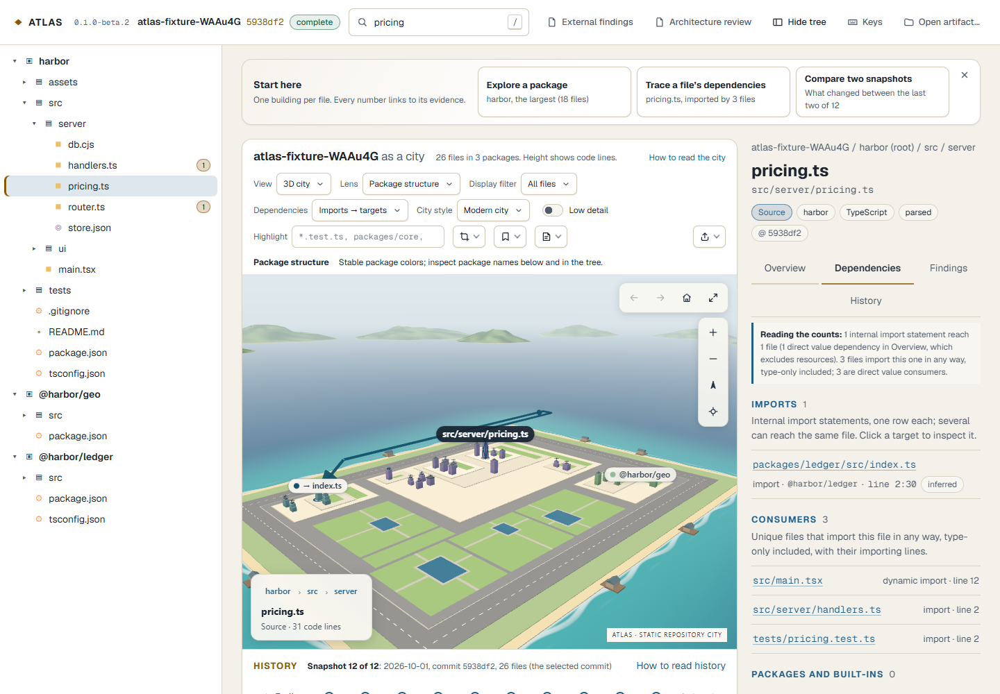

# CLI distribution candidate: fresh-install smoke

Recorded 2026-11-21T09:02:48.872Z on Windows_NT 10.0.26200 x64, Node v24.22.1.

Archive: 11684688 bytes; SHA-256 `c3d6e5d2ae3620a775285de8f64d5bc3fa08033292024c74b25889ac12873aa6`. Source commit `eeae327cc3903252c4da3e0234be8699e3bac3f0`; working tree dirty: true. This candidate is not a signed-off release.

Extracted into a fresh temporary directory outside the checkout, verified every distributed file, and ran without a package manager or any dependency install. CLI entry-process outbound sockets were denied. The browser accepted only the loopback server origin.

- relocated-extraction-and-integrity: passed (1709 files).
- doctor: passed (0.72 s).
- analyze: passed (1.74 s).
- findings: passed (0.61 s).
- findings: passed (0.63 s).
- scan-evidence: passed (0.63 s).
- analyze: passed (2.09 s).
- findings: passed (0.69 s).
- scan-evidence: passed (0.72 s).
- findings: passed (0.64 s).
- scan-evidence: passed (0.62 s).
- review-findings: passed (1.02 s).
- analyze: passed (4.02 s).
- verify: passed (0.73 s).
- inspect: passed (0.64 s).
- review-architecture: passed (0.79 s).
- review-architecture: passed (0.65 s).
- workspace-init: passed (0.63 s).
- workspace-decide: passed (0.65 s).
- workspace-export: passed (0.67 s).
- workspace-import: passed (0.65 s).
- workspace-inspect: passed (0.74 s).
- packaged-browser-city-history-search-and-dependencies: passed.
- packaged-browser-workspace-evidence: passed.
- workspace-import: passed (0.92 s).
- packaged-browser-workspace-draft: passed.

The authored Harbor repository yielded all 12 frames and 26 HEAD files. The bundled viewer opened that artifact, searched with the keyboard and showed its independently checked ledger dependency. Zero page errors or browser outbound requests. Software rendering validates behavior; it is not a reference-GPU benchmark.

Candidate only; human and reference-hardware audits remain open.
The CLI entry process denies outbound sockets. Existing instrumented resolver and offline analyzer-container gates independently cover parsing/analysis.
Archive bytes and every extracted file are verified; this is integrity evidence, not a release signature.
